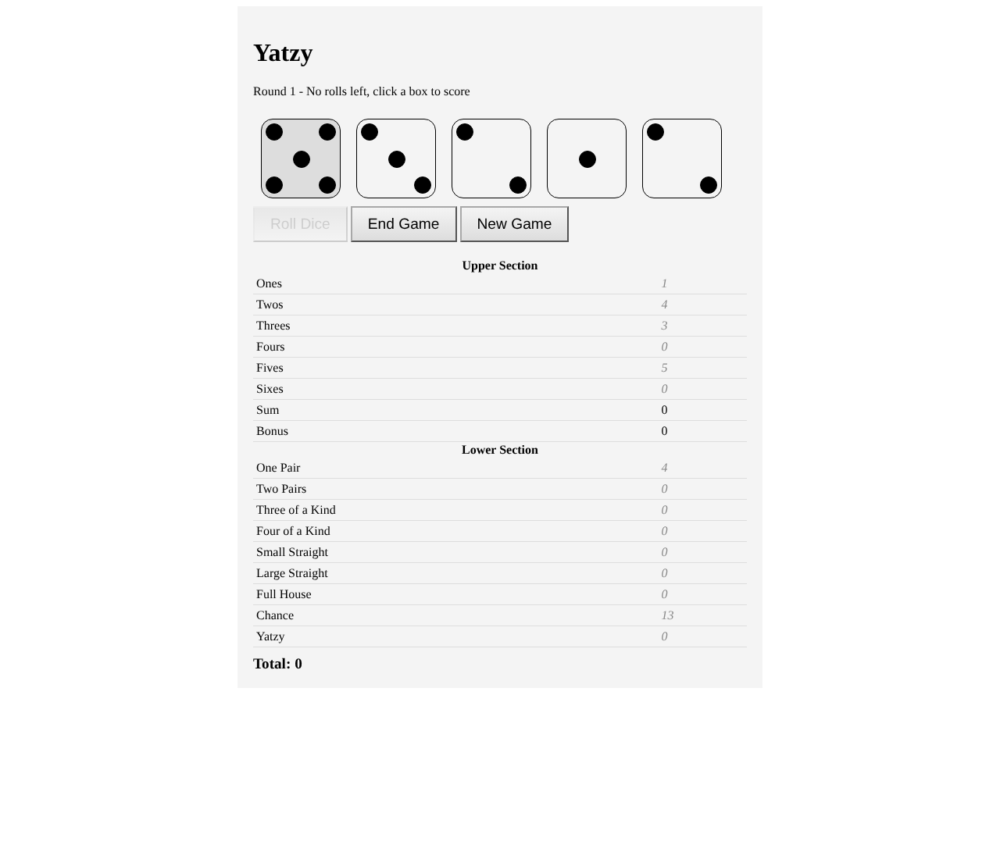
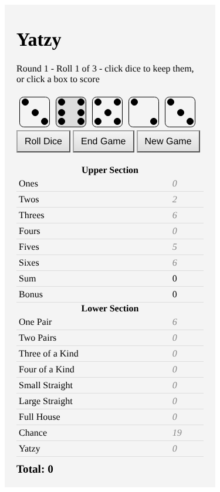

# Yatzy - Assignment 1

CST3106 Assignment 1 - Single-player Yatzy Game

Author: Haotian Li (040961243)

Open `index.html` in a browser to play. No server needed.

## How to Play

1. Click **Roll Dice** to roll the 5 dice. You get up to 3 rolls per turn.
2. Click a die to keep it (it turns grey). Kept dice are not re-rolled. Click it again to un-keep.
3. Click an empty box on the scorecard to score your dice. This ends the turn. The grey numbers show what each box would score.
4. The game ends after 15 rounds (one per box), or when you click **End Game**.
5. Click **New Game** to start again.

## Scoring Rules

| Box | Score |
|---|---|
| Ones - Sixes | sum of that face |
| Bonus | 50 if Ones - Sixes add up to 63 or more |
| One Pair | sum of the highest pair |
| Two Pairs | sum of two different pairs |
| Three of a Kind | sum of 3 same dice |
| Four of a Kind | sum of 4 same dice |
| Small Straight | 1-2-3-4-5 = 15 |
| Large Straight | 2-3-4-5-6 = 20 |
| Full House | 3 of one + 2 of another = sum of all dice |
| Chance | sum of all dice |
| Yatzy | 5 same dice = 50 |

If the dice don't fit a box, it scores 0. A final score of 200 or more gets a congratulation message, below that a consoling one.

## Design

- Light grey game board (`#f4f4f4`) centered on the page, buttons with a grey gradient that flips on hover.
- Dice are drawn with CSS dots (`dice.css`), kept dice have a grey background.
- Scorecard is a table with an upper and lower section. Used boxes are bold, empty boxes show a grey preview score.
- Responsive: the board uses the full width under 900px, and the dice shrink under 600px so all 5 fit on a phone.

## Mock-ups

Desktop:

Mobile:

## Files

| File | What it is |
|---|---|
| `index.html` | game page |
| `styles.css` | game styles |
| `dice.css` | dice styles |
| `dice.js` | `Dice` class - rolling and keeping dice |
| `yatzyEngine.js` | `YatzyEngine` class - scoring rules and score table |
| `app.js` | game state (round, rolls, end of game) and page updates |

## Testing

- All 15 scoring rules checked with sample dice, e.g. `[3,3,3,5,5]` Full House = 19, `[1,2,3,4,5]` Small Straight = 15, `[3,3,3,3,3]` Full House = 0.
- Bonus: upper sum 63 gives 50.
- Roll button disables after 3 rolls, dice can't be kept before the first roll.
- Scoring before rolling or in a used box shows a message instead.
- Full 15 round game and End Game both show the final score.
- Tested at desktop and phone width (375px).
